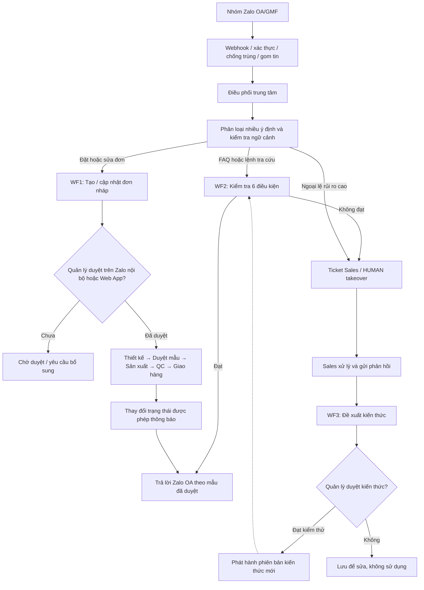

# LBVM — LOGIC TỔNG THỂ 3 WORKFLOW (BẢN TRÌNH DUYỆT V2.2)

**Đơn vị:** Label Vietmax (LBVM)  
**Ngày:** 30/10/2026  
**Trạng thái tài liệu:** Đề xuất trình duyệt — *chưa phê duyệt triển khai*  
**Công nghệ dự kiến:** Zalo OA/GMF (API chính thức) · Codex phát triển · Claude API xử lý AI · Web App LBVM · Cloudflare  
**Quy mô giả định:** 20–50 đơn/ngày; chuyển đổi Zalo cá nhân sang OA/GMF trong 1–2 tháng.

> **Quyết định cốt lõi cần duyệt:** 03 workflow **chạy song song trong MỘT hệ thống**, **không chọn 1 trong 3**. Workflow 3 là vòng học/kiểm duyệt kiến thức, không được tự cập nhật quy tắc trong sản xuất. Một tin nhắn có thể mở nhiều tác vụ, nhưng chỉ có **một bộ điều phối** quyết định nội dung nào được gửi cho khách.

## A. Phân biệt 3 workflow

| Workflow | Đầu vào / trigger | Xử lý tự động | Khi cần người duyệt | Kết quả |
|---|---|---|---|---|
| **WF1 — Đơn hàng & sản xuất** | Tin đặt hàng, sửa đơn; xác nhận quản lý; chuyển trạng thái | Phân tích yêu cầu, gắn mã khách/nhóm, đối chiếu đơn, tạo nháp, tạo lệnh giao việc **sau duyệt** | Chốt thông số, duyệt sản xuất, thay đổi cam kết | Hồ sơ đơn theo phiên bản, nhiệm vụ thiết kế/sản xuất/QC và tiến độ |
| **WF2 — AI CSKH + Sales takeover** | FAQ tự nhiên được phép; lệnh tra cứu đúng cú pháp; ngoại lệ | Tìm kiến thức đã duyệt, dựng câu theo template; kiểm tra quyền & điều kiện gửi | Không đủ nguồn, sai cú pháp, báo giá/giao gấp/khiếu nại, Sales tiếp quản | Một câu trả lời hợp lệ **hoặc** ticket Sales |
| **WF3 — Training & kiểm duyệt AI** | Phản hồi Sales, câu AI lỗi, câu chưa có trong kho | Lưu câu hỏi, bản nháp AI, câu Sales gửi, nguyên nhân; đề xuất FAQ/quy tắc mới | **Quản lý phê duyệt** trước khi xuất bản kiến thức | Phiên bản kho tri thức mới; lịch sử đánh giá |

### Luồng tổng quát — 1 Zalo, 1 backend, 3 workflow

**Điều phối song song:** Cùng một tin có thể tạo nháp ở WF1 và FAQ draft ở WF2. Nếu tin có cam kết rủi ro cao (giá, hạn giao, khiếu nại, sửa đơn có ảnh hưởng sản xuất) hoặc đang có Sales tiếp quản, **không tự gửi câu trả lời chuyên môn**; chuyển Sales và vẫn lưu đơn nháp. Mặc định chỉ **một phản hồi tự động cuối** cho mỗi cụm tin/ý định, tránh trả lời chồng chéo.

## B. Logic kích hoạt và ưu tiên

1. **Nhận tin:** chỉ chấp nhận webhook từ ứng dụng OA/GMF hợp lệ; ghi `event_id`, `group_id`, `sender_id`, thời gian, file/tin gốc; bỏ qua tin của bot, tin trùng và sự kiện không được hỗ trợ.
2. **Gom hội thoại:** ghép các tin liên tiếp trong cửa sổ thử nghiệm 15–20 giây theo nhóm/người/luồng; khi có tin mới phải đánh giá lại trước lúc gửi.
3. **Phân loại đa ý định:** một cụm tin có thể là `ORDER_NEW`, `ORDER_CHANGE`, `FAQ`, `ORDER_STATUS`, `ORDER_SPEC`, `PRICE`, `COMPLAINT`, `OTHER` đồng thời.
4. **Khóa ưu tiên:** nếu có ticket `HUMAN`, khiếu nại hoặc yêu cầu cam kết chưa được duyệt thì không tự trả lời. Ưu tiên xác minh/giải quyết đơn đang bị sửa hơn nội dung FAQ.
5. **WF1:** tạo nháp, không phát lệnh sản xuất cho đến khi quản lý duyệt đúng `order_id + version`. Khi duyệt trên Zalo nội bộ hoặc Web App phải gọi **cùng một API phê duyệt có giao dịch/khóa chống duyệt trùng**.
6. **WF2:** FAQ được hỏi bằng lời tự nhiên nếu nằm trong danh mục đã duyệt. Các lệnh tra cứu **bắt buộc cú pháp** (đề xuất `#LBVM TIENDO DH-001`, `#LBVM THONGSO DH-001`) và kiểm tra đơn thuộc đúng nhóm. Lệnh do backend định nghĩa, không mặc định là tính năng có sẵn trong GMF.
7. **WF3:** sau khi Sales trả lời, hệ thống chỉ tạo **đề xuất kiến thức**; nội dung mới được phép sử dụng sau khi quản lý duyệt và kiểm thử.
8. **Gửi tin:** backend dựng thông điệp từ template và dữ liệu được phép; lưu outbox, kết quả gửi, thử lại khi có lỗi phù hợp; không tự khẳng định đã gửi khi API chưa xác nhận.

### Bộ kiểm tra 6 điều kiện cho WF2

- Đúng loại câu hỏi được phép tự trả lời.
- Đúng cú pháp đầu vào áp dụng cho loại câu hỏi.
- Có nguồn kiến thức/đơn hàng đã được duyệt và còn hiệu lực.
- Đúng cấu trúc mẫu trả lời (không chỉ JSON hợp lệ, còn phải kiểm chứng nội dung).
- Đúng nhóm khách, quyền xem dữ liệu và trạng thái đơn.
- Không có Sales tiếp quản, thông điệp trùng hoặc lệnh tạm ngừng.

**Không đủ bất kỳ điều kiện nào → không tự gửi nội dung chuyên môn → ticket Sales.**

## C. Ví dụ cần được nghiệm thu

**Tin khách:** “Tem nhựa có chống nước không? Anh đặt lại 50.000 cái như đơn trước, thứ Sáu nhận được chứ?”

- WF1: tạo/cập nhật **đơn nháp** 50.000 cái, đối chiếu đơn cũ; đánh dấu cần xác minh ngày giao và vật liệu.
- WF2: phân loại FAQ kỹ thuật + yêu cầu cam kết thời gian; vì có yêu cầu giao hàng chưa được phê duyệt, **không tự xác nhận** hoặc hứa giao đúng hẹn; chuyển Sales xử lý toàn bộ nội dung trả lời ra khách (trừ mẫu thông báo tiếp nhận trung tính được phê duyệt riêng).
- WF3: sau khi Sales xử lý, lưu cặp câu hỏi/câu trả lời để người được phân quyền duyệt bổ sung kiến thức nếu phù hợp.
- Chốt đơn: quản lý duyệt qua **lệnh Zalo nội bộ** (ví dụ `DUYET DH-001 V2`) **hoặc Web App**, trạng thái đồng bộ ngay.

## D. Trạng thái hệ thống và dữ liệu

| Đối tượng | Trạng thái chính |
|---|---|
| Đơn hàng | `DRAFT` → `NEED_INFO` / `PENDING_APPROVAL` → `APPROVED` → `IN_DESIGN` → `AWAITING_SAMPLE_APPROVAL` → `IN_PRODUCTION` → `QC` → `READY_TO_SHIP` → `DELIVERED`; có `CANCELLED` và cơ chế phiên bản đơn |
| Hội thoại CSKH | `AUTO` → `PENDING_SALES` → `HUMAN` → `RESOLVED` → `AUTO` |
| Kiến thức đào tạo | `DRAFT` → `REVIEW` → `APPROVED` → `PUBLISHED` hoặc `REJECTED` / `RETIRED` |

Cần ít nhất các bảng nghiệp vụ: `customers`, `zalo_groups`, `messages/events`, `orders`, `order_versions`, `order_items`, `approvals`, `production_tasks`, `conversation_tickets`, `knowledge_entries`, `knowledge_reviews`, `outbox`, `audit_logs`.

**Phân quyền:** Quản lý duyệt đơn/kiến thức; Sales xử lý khách và đơn nháp theo quyền; thiết kế/sản xuất chỉ thấy công việc được phân công; Admin quản trị quyền và cấu hình. Web App và bot Zalo dùng chung quy tắc server.

## E. Kế hoạch và chi phí

- **PA2 được đề xuất:** Codex để phát triển; Claude API cho AI; Cloudflare Workers/D1/R2; Zalo OA/GMF; Web App LBVM.
- **Đã tính hai thuê bao phát triển:** ChatGPT Plus khoảng **516.000đ/tháng** và Claude Pro khoảng **516.000đ/tháng** theo tỷ giá tham khảo 30/10/2026.
- **Dự toán nền PA2:** **2,34–3,09 triệu đồng/tháng**, theo giả định **30 nhóm khách + 3 nhóm nội bộ = 33 nhóm GMF-10**. Mức mục tiêu ~3 triệu/tháng **chưa bảo đảm bao trọn AI CSKH** vì chưa đo số câu hỏi, lượt gọi Claude và phí tin từ 2027.
- **Chuyển đổi:** 1–2 tháng từ nhóm cá nhân sang OA/GMF; nhóm cũ do Sales nhập/chuyển tiếp thủ công trong giai đoạn quá độ.
- **Mốc triển khai mục tiêu:** 8 tuần; xác minh quyền OA/GMF, webhook, nhận/gửi tin trên nhóm thử **trước** khi nhân rộng. Không cam kết chính xác 100% trước nghiệm thu.

## G. Backlog giai đoạn 2 — Tối ưu AI CSKH (không nằm trong scope 8 tuần V1)

**Quyết định bổ sung V2.2:** Bảy đề xuất tối ưu CSKH được xếp vào giai đoạn sau khi V1 đã vận hành ổn định. Đây là **backlog cần phê duyệt trước khi triển khai**, không phải cam kết xây ngay trong giai đoạn đầu.

| Mã | Hướng tối ưu sau V1 | Mục tiêu |
|---|---|---|
| CS2-01 | Ngữ cảnh hội thoại nâng cao | Tách nhiều chủ đề/ticket cùng một nhóm, liên kết đúng khách, sản phẩm và mã đơn |
| CS2-02 | Khóa AI theo từng vấn đề | Sales tiếp quản từng ticket; các câu hỏi độc lập vẫn có thể được hỗ trợ; tùy chọn tạm dừng cả nhóm |
| CS2-03 | Phân tầng rủi ro 3 cấp chi tiết | FAQ cơ bản / tư vấn kỹ thuật có điều kiện / cam kết thương mại |
| CS2-04 | Ticket và SLA cho Sales | Phân công, ghi nhận đã tiếp nhận, nhắc hạn, chuyển cấp và theo dõi đã giải quyết |
| CS2-05 | Kho kiến thức kỹ thuật hai lớp | FAQ chung + tài liệu sản phẩm, vật liệu, keo và điều kiện sử dụng; kiểm soát phiên bản |
| CS2-06 | Tối ưu chi phí, tần suất AI/tin GMF | Không gọi LLM khi không cần, lọc tin xã giao, cache FAQ, giới hạn phản hồi |
| CS2-07 | Dashboard chất lượng & bộ test | Đo độ đúng, tỷ lệ tự xử lý/chuyển Sales, sai ngữ cảnh, chi phí/ticket |

**V1 vẫn bắt buộc có các kiểm soát nền:** xác minh nhóm và quyền xem đơn, chống trùng tin, dữ liệu/kiến thức đã được duyệt, không tự cam kết thương mại, Sales takeover tối thiểu theo ticket, lưu lịch sử và cơ chế dừng AI. Không hoãn những yêu cầu an toàn này sang V2.

**Điều kiện mở V2:** V1 nghiệm thu và đã sử dụng với nhóm GMF thực tế; thu được câu hỏi mẫu, số lỗi, khối lượng cuộc trao đổi và chi phí; quản lý duyệt ưu tiên, phạm vi, KPI và ngân sách riêng. Chưa cố định thời gian hoặc giá phát triển/nâng cấp V2 do chưa có dữ liệu đo lường.

**Hệ quả ngân sách:** dự toán nền PA2 (2,34–3,09 triệu/tháng theo 33 nhóm GMF-10) không tự động bao gồm chi phí phát triển và vận hành tất cả hạng mục CS2-01…CS2-07.

## F. Danh sách quản lý cần duyệt

- [ ] **D1 — Kiến trúc:** Đồng ý 3 workflow chạy song song, cùng một bộ điều phối và database.
- [ ] **D2 — Phê duyệt đơn:** Đồng ý duyệt qua GMF nội bộ **hoặc** Web App; cả hai ghi người duyệt, mã đơn và phiên bản.
- [ ] **D3 — AI CSKH:** Đồng ý “BOTH + chủ động có chọn lọc”; FAQ tự nhiên nhưng tra cứu đơn theo cú pháp chuẩn.
- [ ] **D4 — Giới hạn AI:** Không tự báo giá chưa duyệt, hứa lịch giao, xác nhận sửa đơn, trả lời khi có Sales tiếp quản.
- [ ] **D5 — Training:** Mọi kiến thức mới cần quản lý duyệt trước khi xuất bản; không học tự động từ mọi câu Sales.
- [ ] **D6 — Dữ liệu & quyền:** Phân quyền nhóm khách, lưu nhật ký, giữ phiên bản đơn và chống lặp.
- [ ] **D7 — Chi phí & lộ trình:** Chấp thuận PA2 làm hướng nền; cập nhật lại ngân sách sau đo thực tế và xác minh chi phí GMF 2027.
- [ ] **D8 — Giai đoạn sau:** Chấp thuận xếp 7 tối ưu AI CSKH vào backlog V2 sau nghiệm thu V1; chưa cam kết thời hạn/chi phí V2.

**Tình trạng duyệt:** Chưa có phê duyệt chính thức. Các ô trên dành cho người quản lý xác nhận.  
**Ranh giới phạm vi:** Đây là bản logic/phân tích, chưa phải ứng dụng đã được tích hợp hay thử nghiệm với Zalo OA của LBVM.

---
**Tài liệu đầy đủ (HTML):** [Kế hoạch AI Zalo OA — LBVM 2026](./ke-hoach-ai-zalo-oa-lbvm-2026.html)
